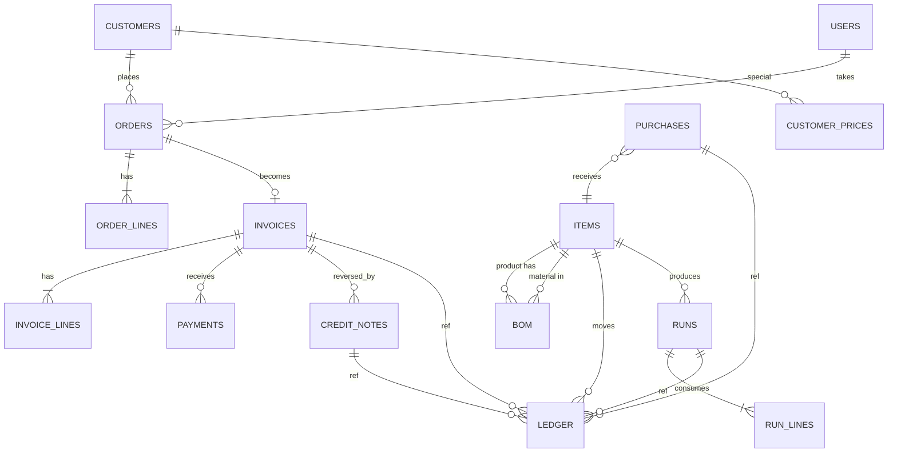

# Design note
## Data model

Other tables: `suppliers`, `adjustments` (→ ledger), `monthly_overheads`, `visits`, `audit`.
## Stock
No balance is stored. Balance = `SUM(ledger.qty_m)`; each row has `ref_type/ref_id` (opening, purchase, production, invoice, credit_note, adjustment), user, date, **batch, expiry**. Issues allocate first-expiry-first-out, one row per batch. Returns go back into the batches originally dispatched. The stock summary checks opening + receipts − issues = closing per item. Quantities are integer milli-units; money integer paise (`Decimal` only in conversions and costing).
## BOM consumption
planned = BOM qty → item base unit (`conv`: kg/g, l/ml, pcs/packet/carton) × batches; actual defaults to planned. A run has two stages: *start* issues materials (FEFO) into a per-product WIP item, *complete* clears WIP and posts good output as a new batch (expiry = date + shelf life); a same-day run does both in one transaction. Variance = (actual − planned)/planned; flagged when |v| > 3% (`VARIANCE_TOLERANCE`); yield compares good packets to `yield × batches`. Editing a run posts only the delta and logs old→new.
## Costing
Weighted-average cost per item, recomputed on every purchase; run material = actual qty × WAC at run time. Per-run cost/packet = (material + run labour/power) ÷ good packets. Monthly overheads are allocated across runs pro-rata to good packets (Costing report).
## GST / audit
Place of supply from customer state: intra → CGST+SGST, inter → IGST; per-line half-up rounding; `INV/<FY>/<seq>`. Posted invoices are never edited or deleted: cancel → credit note (+ stock back); partial return → credit note. GSTR-1 (B2B, HSN, CDNR) and GSTR-3B 3.1(a) reports are derived from invoices and credit notes. The `audit` table records user, time, action, entity and detail (viewable in-app).

A PDF version with a drawn diagram is in `DESIGN.pdf` (2 pages; regenerate with `python tools/make_design_pdf.py`).
